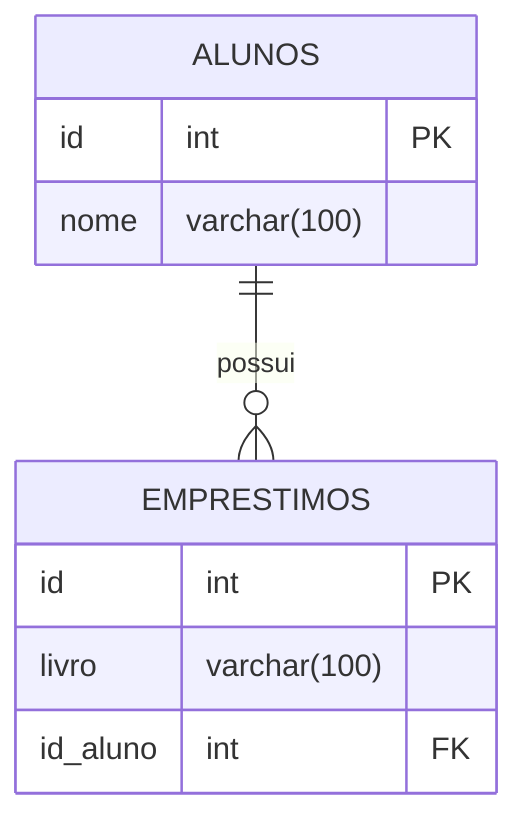

## 💡 Atividade prática 10 - Relacionamento entre tabelas

**Objetivo:** A biblioteca da escola anota os empréstimos de livros em um caderno, e a bibliotecária não consegue saber com facilidade quem está com cada livro. Vocês vão montar um pequeno banco de dados para ajudar.

## Diagrama


-**FK**: Chave estrangeira, que identifica o aluno através do ID de outra tabela.

-**PK**: Chave primária, que identifica cada registro da tabela.

1- Criamos a tabela de alunos:
```sql
CREATE TABLE alunos(
    id SERIAL PRIMARY KEY,
    nome VARCHAR(100) NOT NULL
);
```

2- Criamos a tabela de empréstimos e já com a coluna referenciada `id_aluno`:
```sql
CREATE TABLE emprestimos(
    id SERIAL PRIMARY KEY,
    livro VARCHAR(100) NOT NULL,
    id_aluno INT REFERENCES alunos(id)
);
```

3- Cadastramos os 15 alunos:
```sql
INSERT INTO alunos (nome) VALUES
('Isabela'),
('Bruno'),
('Thomas'),
('Rafaela'),
('Eduardo'),
('Fernanda'),
('Gabriel'),
('Helena'),
('Manuella'),
('João'),
('Karina'),
('Lucas'),
('Mariana'),
('Nicolas'),
('Olivia');
```

4- Cadastramos os 10 empréstimos. Os alunos de 11 a 15 não possuem livros:
```sql
INSERT INTO emprestimos(livro, id_aluno) VALUES
('Harry Potter', 7),
('O Pequeno Príncipe', 2),
('Turma da Mônica', 10),
('O Hobbit', 4),
('Percy Jackson', 1),
('Diário de um Banana', 9),
('A Culpa é das Estrelas', 5),
('Jogos Vorazes', 8),
('Extraordinário', 3),
('Dom Casmurro', 6);
```

5- Para exibir todos os dados da tabela de alunos:
```sql
SELECT * FROM alunos;
```

6- Para exibir todos os dados da tabela de empréstimos:
```sql
SELECT * FROM emprestimos;
```

7- Para exibir o nome do aluno e o livro que ele pegou utilizando `INNER JOIN`:
```sql
SELECT alunos.nome, emprestimos.livro
FROM emprestimos
INNER JOIN alunos ON emprestimos.id_aluno = alunos.id;
```
Com o `INNER JOIN`, somente os alunos que possuem algum empréstimo aparecem.

Os alunos que não apareceram foram **Karina, Lucas, Mariana, Nicolas e Olivia**, porque eles não possuem nenhum livro emprestado.

8- Para exibir todos os alunos, inclusive aqueles que não pegaram nenhum livro:
```sql
SELECT alunos.nome, emprestimos.livro
FROM alunos
LEFT JOIN emprestimos ON emprestimos.id_aluno = alunos.id;
```

Os alunos que não possuem livro aparecem com **NULL** na coluna `livro`.

9- Para exibir somente os alunos que nunca pegaram livro:
```sql
SELECT alunos.nome
FROM alunos
LEFT JOIN emprestimos ON emprestimos.id_aluno = alunos.id
WHERE emprestimos.id IS NULL;
```
O resultado será:
```text
Karina
Lucas
Mariana
Nicolas
Olivia
```

10- Tentamos cadastrar um empréstimo para o aluno 50:
```sql
INSERT INTO emprestimos(livro, id_aluno)
VALUES ('Turma da Mônica', 50);
```

O comando apresenta um erro porque o aluno com `id = 50` não existe na tabela `alunos`.

Isso acontece por causa da chave estrangeira:

```sql
id_aluno INT REFERENCES alunos(id)
```

A chave estrangeira faz com que o `id_aluno` informado na tabela `emprestimos` precise existir primeiro na tabela `alunos`.